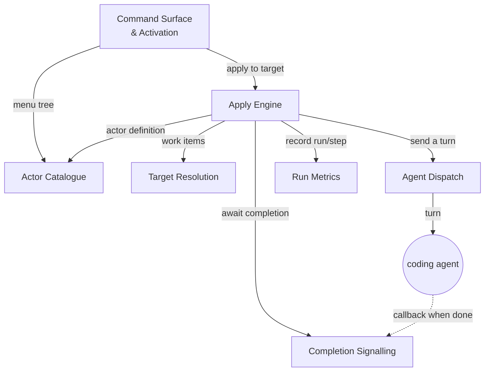

# Dust — Component Map (Top Layer)

> **Status:** Component map — the top layer only: feature-components and how they collaborate. Concrete interfaces, data schemas, and internal decomposition are deferred to each component's own refinement cycle, not fixed here.

**Scope:** the committed top layer, drawing on `dust-tech-design.md` and `dust-extension-hld.md` for product intent. It supersedes the committed intent of `dust-architecture-decomposition.md`, which is now reasoning input for a component's own refinement, not a design to build to. This is a clustering of the logic into cohesive components plus their interactions. It deliberately does not stand up a foundation of shared schemas first; the shared shapes emerge from the components that own them, as each is refined.

## How to Read This

- **Components are feature clusters, not layers.** Each is a cohesive slice of behaviour that owns its own logic — and, in time, its own schema. There is no separate "foundation" tier; shared types are grown from the component that needs them, not designed up front.
- **Interactions are abstract.** The arrows below say what one component asks of another (the intent), not the concrete interface or payload. Fixing those signatures is refinement work, deferred on purpose.
- **This is the layer we commit now.** Per the planning-as-a-cycle principle, we commit this map and refine one component at a time; what each refinement learns (including its schema) feeds back into the components it touches.

## Key Components

- **Actor Catalogue** — turns actor files across the configured roots into an ordered, menu-ready model: discovery, parsing, folder-vs-multi-step classification, nearest-wins merge, prefix ordering. Owns the actor model the rest of the system reads. Largely liftable from the ash-js parser/loader. *Refined later: the actor definition and the tree read-model it exposes.*

- **Target Resolution** — turns an Explorer selection into the set of work items to apply to: file vs folder, recursion, and per-item vs whole-folder scope. Owns all traversal. *Refined later: the work-item shape it yields.*

- **Apply Engine** — the core loop and the only place sequencing lives: expand an actor into turns, iterate targets, compose each turn, dispatch, await completion, advance. Owns orchestration and the correlation of in-flight turns. *Refined later: the turn/correlation model and how much may run concurrently.*

- **Agent Dispatch** — hands a composed turn to the coding agent and selects the role/mode it runs under. Owns the outbound edge to the agent. *Refined later: the dispatch call and the role→mode mapping.*

- **Completion Signalling** — learns when a dispatched turn has finished and matches the signal back to the waiting turn; spans the in-editor listener and the small external callback the agent invokes on completion. Owns the inbound completion edge. *Refined later: the signalling channel and the callback's contract.*

- **Command Surface & Activation** — the Explorer menu that lets a user trigger an apply, plus the wiring that assembles the components at startup. Owns the UI trigger and composition root. *Refined later: the command/menu contributions and config surface.*

- **Run Metrics** — optional, best-effort recording of runs that never disrupts a run. Owns observation. *Refined later: what a run record captures and where it is kept.*

## How They Interact (Abstract)

Read every arrow as an intent, not an interface:

- **Command Surface** asks the **Catalogue** for the actor tree to render in its Webview panel, and on a run invokes the **Apply Engine** with the chosen actor and the clicked target.
- The **Apply Engine** asks the **Catalogue** for the actor's definition and **Target Resolution** for the work items, then per turn sends via **Agent Dispatch** and awaits via **Completion Signalling** before advancing, emitting progress to **Run Metrics**.
- **Completion Signalling** is woken by the agent's out-of-band callback and matches it to the turn the engine is waiting on.

None of these arrows commits a concrete schema. The payloads — "actor definition", "work items", "a turn", "a completion", "a run record" — stay abstract until the owning component is refined.

## Deliberately Deferred (Worked Out During Refinement)

- **No foundation-first schema tier.** The shared shapes (actor definition, work item, completion signal, run record) are not designed up front; each is owned and defined by its component when that component is refined.
- **Interfaces between components** stay abstract until both sides are refined — the interaction's intent is fixed here, its signature is not.
- **Transport & mechanism** (how completion travels, how the menu is contributed, where metrics persist) are component-internal and out of scope for this layer.

## How to Proceed (One Component per Cycle)

Commit this map, then refine one component at a time. Start where the interactions converge — the **Apply Engine** — since its needs shape what the Catalogue, Target Resolution, Agent Dispatch, and Completion Signalling must each offer. Refining a component is where its schema and interface get worked out; feed those learnings into the neighbours it touches before moving on. Expect the arrows above to sharpen — and occasionally move — as each component is refined.
