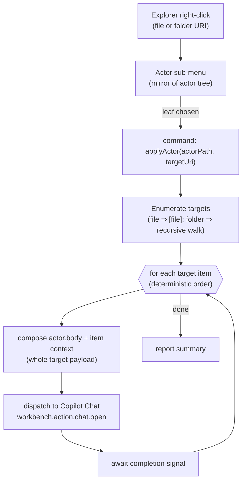
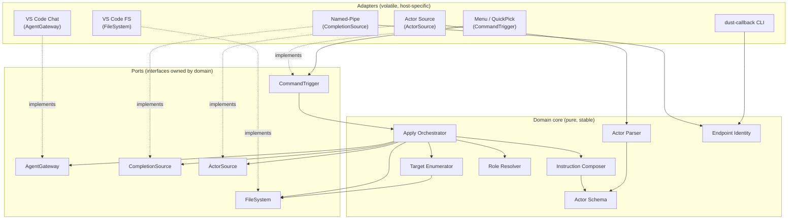
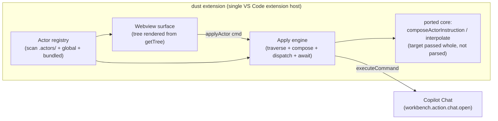

# Dust — Technical Design

> **Status:** Technical Design (companion to the HLD)  
> **Scope:** the mechanisms behind Dust. The HLD (`dust-extension-hld.md`) states what we build and why; this document states how each capability works.

The component/SOLID decomposition lives in `dust-architecture-decomposition.md`. Section references like §2 or §5 point to the HLD unless stated otherwise. Where the HLD says "→ see tech design", the matching section number here is the target.

## Contents

1. Actor discovery & resolution
2. Folder classification (sub-menu vs multi-step actor)
3. Actor file format & interpolation
4. Front-matter schema & validation
5. Model role → chatmode resolution
6. Engine mechanics (enumeration, traversal, scope, expansion)
7. Reuse map from the existing code base
8. Completion signalling transport
9. Run-metrics persistence (SQLite)
10. Configuration & command surface

## 1. Actor Discovery & Resolution

Actors are discovered from three roots, merged nearest-wins by relative path (exactly Ash's `actors/` cascade, re-pointed):

| Priority | Root | Scope |
|----------|------|-------|
| Highest | `<workspace>/.actors/` | Project-local, user-defined |
| Middle | `~/.dust/actors/` | User global |
| Lowest | extension's bundled `actors/` | Predefined defaults |

Merge across the three roots by relative path; project-local overrides global overrides bundled for the same path. Numeric prefixes drive display order (Ash convention) and are stripped from the label. A folder becomes a nested sub-menu; a `.md` file becomes a leaf command. The tree is recursed to any depth — a pure structural mirror.

Example layout → menu mapping:

```
.actors/
  01-solutioning.md            → "Solutioning"
  02-design/                    → sub-menu "Design"
     01-ux.md                   →   "Ux"
     02-technical.md            →   "Technical"
     03-component-architecture.md → "Component Architecture"
  03-plan.md                   → "Plan"
  04-scaffold.md               → "Scaffold"
  05-implement.md              → "Implement"
```

Resolution reuses `resolveActorDir` (~70%): concept kept, re-pointed at the three roots and extended to recurse into sub-menus.

## 2. Folder Classification (Sub-Menu vs Multi-Step Actor)

A single menu leaf the user clicks — an actor — is one of two shapes, applied over each target identically:

### Single-File Actor

One `.md` file = one dispatch per target (e.g. `01-solutioning.md`).

### Multi-Step Actor

A folder whose contents are numbered-prefix `.md` step files; the engine runs those steps in numeric order over the same target (Ash's `actors/` do → assess → rework idea):

```
05-implement/                → menu leaf "Implement"
   01-implement.md            →   step 1 over the target
   02-assess.md               →   step 2 over the same target
   03-rework.md               →   step 3 over the same target
```

### Disambiguation Rule

Whether a folder is a branch (sub-menu) or a leaf (multi-step actor):

- Direct children are numbered `.md` step files → **multi-step actor** (leaf).
- Contains sub-folders and/or non-step actors → **sub-menu** (branch).
- Optional explicit marker (e.g. an `actor.yml` / `_actor` sentinel) can force the "leaf" interpretation when a folder mixes both.

Each step file carries its own front-matter (`subagent`, `model`), so different steps can use different personas/models. The whole target is passed as the payload — no per-section selection.

### Composition

Because a multi-step actor is just an ordered set of step files, actors compose: concatenate/reference existing single/multi-step actors into one longer numbered sequence (e.g. `implement/ = plan + code + assess + rework`), indistinguishable to the engine from any other actor. *(Composition mechanism — inline copy vs reference/include — to be decided later.)*

## 3. Actor File Format & Interpolation

Each actor file is exactly the Ash actor format already in use:

```yaml
---
model: Reason    # abstract role (§5) — the kind of intelligence the step wants
---
```

```
You are a solutioning architect. Read ${targetContent} and produce a Solution.md that …
```

Interpolation slots, filled by the engine (identical to `composeActorInstruction` today):

- `${targetContent}`
- `${targetPath}`
- `${targetRelPath}`
- `${targetFileName}`

## 4. Front-Matter Schema & Validation

Dropping reads (full-payload) leaves a small, closed schema:

| Key | Type | Applies to | Meaning |
|-----|------|-----------|---------|
| `title` | `string` | actor / step | Optional display label override (else derived from filename, prefix-stripped). |
| `model` | role enum (`Reason` \| `Build` \| `Review` \| `Write` \| `Repair`) | actor / step / target | Abstract model role → resolved role→chatmode→model (§5). Not a specific LLM id. |
| `subagent` | `string` | actor / step | Chat mode / persona hint. |
| `scope` | `item` \| `folder` | actor / step | Per-item iteration vs whole-target-as-one-unit (§6). Default `item`. |

- Closed set — unknown keys are ignored (forward-compatible) but not relied on.
- No reads, no section selection.
- Target files honor only `model`; the rest are actor-side.
- Validate at load with a TypeBox schema (repo convention — zod is Nexus-flagged here), so malformed front-matter fails fast with a clear message. *(Exact key names/defaults to be finalized when we build the loader.)*

## 5. Model Role → Chatmode Resolution

`model` names an abstract role (`Reason`, `Build`, `Review`, `Write`, `Repair`), not an LLM id, so actors stay portable as models change. Both the actor/step file and the target markdown file may specify one:

```yaml
---
model: Reason    # abstract role, not a specific LLM
---
```

```yaml
---
model: Build     # per-target override, wins over the actor's role
---
# Goal
…
```

### Predefined Roles (Finalized Set of Five)

| Role | Purpose |
|------|---------|
| **Reason** | reasoning, solutioning, architecture, planning |
| **Build** | implementation, scaffolding, code generation |
| **Review** | review, assessment, gap-finding (the assess step) |
| **Write** | documentation, summarization, prose/specs |
| **Repair** | debugging, refactor, rework from feedback (the rework step) |

Extensible — map a new name to a chatmode; the five above are the built-in defaults.

### Role Profiles

What an ideal model for each role looks like. Roles are abstract, but each names a shape of work with distinct demands. The last column is a suggestion for the `dust.roleChatmodes` mapping, not a hard binding.

| Role | Kind of work | Ideal-model characteristics | Context need | Reasoning depth | Suggested model / context / think options |
|------|-------------|---------------------------|--------------|-----------------|------------------------------------------|
| Reason | Solutioning, architecture, planning, trade-off analysis | Strong multi-step reasoning, breadth of world knowledge, weighs alternatives, resists premature commitment | Large — whole design docs, cross-file intent | High (extended/deep thinking) | Frontier reasoning model (e.g. GPT-5 / Claude Opus 4.x) · large context (≥128k) · think: high / extended |
| Build | Implementation, scaffolding, code generation | Precise code synthesis, strong tool/format adherence, fast, low hallucination on APIs | Medium — target file + local neighbours | Low–medium | Strong coding model (e.g. Claude Sonnet 4.x / GPT-5-Codex) · medium context (~64–128k) · think: low–medium |
| Review | Review, assessment, gap-finding (the assess step) | Critical, skeptical, thorough; good at spotting omissions, risks, and inconsistencies against a spec | Large — code + spec/acceptance criteria together | Medium–high | Reasoning-leaning model · large context (whole diff + spec) · think: medium–high |
| Write | Documentation, summarization, prose/specs | Clear, concise prose; faithful summarization; consistent tone and structure | Medium–large — full source to summarize | Low–medium | General-purpose writing model (e.g. Claude Sonnet 4.x / GPT-5) · large context for summarization · think: low |
| Repair | Debugging, refactor, rework from feedback (the rework step) | Diagnostic reasoning, root-cause focus, careful surgical edits, respects existing structure | Medium — failing file + error/feedback | Medium–high | Coding-plus-reasoning model · medium context (file + logs/feedback) · think: medium–high |

### Precedence

Target-file `model` overrides actor `model` overrides the `dust.defaultRole` config default (same most-specific-wins spirit as `subagent`).

### Mechanism

VS Code exposes model selection through its chatmode mechanism. The engine maps role → chatmode → model via a configurable `dust.roleChatmodes` table (e.g. Reason → a reasoning chatmode, Build → a coding chatmode) and dispatches with that mode. The dispatch wrapper (`resolveMode`, ported from `copilot-bridge.js`) is extended to map a requested role → its chatmode, falling back to the default when no mapping exists.

## 6. Engine Mechanics



### Target Enumeration

- Target is a **file** → the single file is the one work item.
- Target is a **folder** → walk recursively in deterministic (numeric-then-lexical) order, yielding files (and optionally sub-folders for "whole-folder" actors). This is Ash's `collectWorkflowFiles` traversal minus the .ash language branch (~60% reuse: keep ordering, drop .ash/task semantics, generalize to arbitrary files).

### Target-Type Awareness

Three target shapes:

| Shape | Behaviour |
|-------|-----------|
| Ordered folder (numbered tree) | Actionable plan → per-item iteration in deterministic order. |
| Unordered folder (random related files, e.g. `design/`) | Apply the actor over the folder as one unit (e.g. "Summarize"), not file-by-file. |
| Single file (markdown-first) | One application; the whole file is the payload. |

Decided by two signals: the actor's `scope: item | folder` front-matter drives engine behavior (engine stays dumb); target heuristics live in the UX only to offer sensible actors/modes. *(To elaborate later.)*

### Actor Shape (Single vs Multi-Step)

For each target item the engine dispatches either one turn (single-file actor) or K ordered turns (multi-step actor — one per numbered step, each awaiting completion before the next). Same 1 → K dispatches expansion Ash's `executeWorkflowFile` does via `loadActors` + `composeActorInstruction`.

### Scope Granularity

Two dispatch shapes, chosen by the actor:

- **Per-item:** one dispatch (or step-sequence) per file (e.g. "Implement" over each task file).
- **Whole-target:** one dispatch (or step-sequence) consuming the whole folder as context (e.g. "Plan" over `designs/`). Signalled by `scope: folder`.

**Completion.** After each dispatch the engine must know the agent turn is "done" before advancing — see §8.

## 7. Reuse Map from the Existing Code Base

Rough reuse estimate. Percentages are fraction of that concern's logic that ports with little/no change.

| Concern | Existing asset | Reuse | Notes |
|---------|---------------|-------|-------|
| Actor model (parse actor md, front-matter, subagent/model) | `ash-js/src/directory-mode.ts` (`parseMarkdownTask`, `loadActors`, `loadActorFile`) | ~90% | Lift almost verbatim; drop CLI-state coupling and reads section selection. |
| Section assembly / context (`parseMarkdownSections`, `extractPreamble`, `assembleTaskContext`, orphan handling) | `directory-mode.ts` | ~90% | Pure functions, no I/O beyond read. Directly portable. |
| Instruction composition (`composeActorInstruction`, `${targetContent}` slot, interpolation) | `directory-mode.ts` + `interpolate.ts` | ~95% | Copy as-is. |
| Actor-tree resolution / nearest-wins cascade | `resolveActorDir` | ~70% | Concept reused; re-pointed at `.actors/` + global + bundled, and extended to recurse into sub-menus. |
| Recursive target traversal / ordering | `collectWorkflowFiles` (numeric-prefix ordering) | ~60% | Keep ordering logic; drop .ash/task semantics; generalize to arbitrary files. |
| Agent dispatch into Copilot Chat | `ash-vscode-syntax/copilot-bridge.js` (`sendToCopilot` → `workbench.action.chat.open`, `resolveMode`) | ~85% | We are already inside the extension host, so we call `vscode.commands.executeCommand` directly — no named pipe, no socket server for dispatch. Delete all transport/endpoint code on the dispatch path. |
| .ash editor tooling (grammar, formatter) | `ash-vscode-syntax/extension.js`, `syntaxes/` | 0% (optional) | Not needed unless we also want .ash editing; the new extension has no language. |
| Completion coordination (mandatory callback) | `ashd/*`, `ash-protocol/*`, `ash-js/protocol-client.ts`, `copilot-bridge.js` (`endpointForWorkspace`) | ~30% | Drop the daemon/router/SQLite/WS stack. Reuse the workspace-keyed pipe naming (`endpointForWorkspace`) for the extension listener + a new global `dust-callback` bin (§8). |
| Menu contribution / commands | *(none — Ash has no Explorer menus)* | 0% (new) | New `package.json` single `menus.explorer/context` command that opens a Webview command surface; the actor tree is rendered inside the Webview from the Catalogue's `getTree()`, not projected onto static submenu contributions. |

### Net Picture

- **Reuse heavily** (copy with light edits): the entire actor + context + composition core (`directory-mode.ts` pure functions + `interpolate.ts`) and the one-line Copilot dispatch call (~90% portable).
- **Reuse the idea, rewrite thin:** traversal/ordering and nearest-wins actor resolution (~60–70%).
- **Delete outright:** `ashd`, `ash-protocol`, `protocol-client`, correlation routing, the named-pipe/UDS dispatch transport, the .ash parser/executor/CLI, and the .ash grammar/formatter.
- **Build new (small):** the Explorer context-menu entry that opens a Webview command surface (renders the actor tree 1:1 from `getTree()`, previews the chosen actor, and collects per-run tweaks — model, scope, and a free-text addendum), and the completion strategy (§8).

Bottom line: roughly 50–60% of the logic you would otherwise write can be lifted from `directory-mode.ts` + `copilot-bridge.js` + `interpolate.ts`, while the bulk of the original repository (daemon, protocol, language runtime) is dropped.

## 8. Completion Signalling Transport

The callback is mandatory: the engine must know when the agent finished a turn before dispatching the next step/file. Since Copilot exposes no public turn-status API, the agent itself signals "done".

### Solution — Workspace-Keyed Named Pipe + Global Callback CLI

- **Extension** owns a named pipe whose name embeds the workspace identity (label + path hash), exactly like Ash's `endpointForWorkspace` scheme, so multiple windows don't cross-talk. The extension writes the resolved endpoint to a discovery file (`<workspace>/.dust/endpoint.json`).
- A small **callback CLI** installed to the npm global is invoked by the agent at the end of each step (baked into the actor prompt). It resolves the current workspace's pipe (from the discovery file / env) and writes a completion frame directly to the pipe — no daemon, no WebSocket; an in-process listener on the extension side resolves the awaiting step.
- On receiving the frame the engine resolves the step's waiter and advances.

**Distinct name.** The bin is `dust-callback` (package e.g. `@dust/callback` exposing bin `dust-callback`); it must not collide with the existing `ash-callback` global.

### Callback Input Contract (Finalized)

The bin takes four mandatory fields:

| Field | Flag | Purpose |
|-------|------|---------|
| `status` | `--status <done\|error\|needs-input>` | Authoritative turn outcome; drives the waiter and the step row's status. |
| `correlation_id` | `--id <id>` | Routes the frame to the exact awaiting step. Required so parallel requests / parallel steps in the same run resolve the right waiter (Dust has no ashd router to do this). |
| `summary_file` | `--summary <path>` | Path to the task summary as schema-ed JSON (validated with the §4 TypeBox convention): `outcome_score`, `actions`, `notes` — the exact §9 step-summary payload. |
| `workspace` | `--workspace <id\|path>` | Selects which pipe to talk to (resolves `.dust/endpoint.json` for that workspace). Ash omits this because ashd centralizes routing; Dust has one listener per workspace, so the caller must name it. |

- `correlation_id` is non-optional precisely because the engine may have more than one step in flight (parallel targets, or parallel steps within a run); without it a frame cannot be attributed.
- `summary_file` is a file path (not inline) so large summaries never hit argv limits; the callback writes JSON, the extension reads + validates it, then hands the parsed object to the metrics sink (§9) on the same resolve path.
- `workspace` replaces Ash's daemon routing: the pipe name is `\\.\pipe\dust-<label>-<hash>`, and this field supplies the `<label>/<hash>` identity (or a path the bin hashes) when the discovery file alone is ambiguous (e.g. multiple windows).

`--help` is mandatory. The `dust-callback` bin must implement a `--help` (and `-h`) flag that prints its full usage — every flag above, its type, whether it is required, and a copy-pasteable example invocation. This is not cosmetic: the agent is the primary caller, so `dust-callback --help` is the contract it consults to self-correct when unsure of the arguments. The help text is the single source of truth for the flag surface and must stay in sync with this section.

### Flow

```
agent finishes step  →  dust-callback --status done \
                            --id <correlationId> \
                            --summary <path/to/summary.json> \
                            --workspace <id|path>
                           │ resolves the workspace's pipe from .dust/endpoint.json
                           ▼
               \\.\pipe\dust-<label>-<hash>   (extension listener)
                           ▼
               engine: match correlation_id → resolve waiter → dispatch next step/file
```

### Why Simpler than Ash's Stack

No ashd singleton, no correlation router, no routing SQLite (the metrics store in §9 is a separate, observability-only concern), no protocol library — the listener lives inside the extension and routing is implicit in the per-workspace pipe name. We keep only the one piece Ash proved indispensable: an out-of-band, agent-driven completion signal.

The engine waits indefinitely for the callback. If the agent never calls back (crash, hang, or user wants to force-advance), the user can invoke `dust-callback` manually from the terminal with the appropriate `--id` and `--status` flags to end the step.

## 9. Run-Metrics Persistence (SQLite)

Ash ships a full telemetry stack (span/point events over the protocol client, daemon fan-out — see `ash-js/src/telemetry.ts`). Dust deliberately does not adopt that machinery (no daemon, no protocol channel, no WebSocket). Instead it persists a small, local run-metrics store in SQLite, owned by the extension.

> **Not the SQLite we dropped.** §7/§8 dropped Ash's daemon-side correlation/routing SQLite. This is a different, single-process store whose only purpose is observability/analytics of each apply run — it never participates in completion routing.

### Where

One database per workspace at `<workspace>/.dust/metrics.db` (plus, optionally, a roll-up in the global `~/.dust/`). Best-effort: a failed write must never disrupt an apply run (same spirit as Ash telemetry — synchronous best-effort, silently dropped on failure).

### Grain

One physical table, one row per step. A step is one dispatched turn within a run (one file, or one numbered step). Run-level attributes are denormalized onto each row (constant per `run_id`); run-level rollups (`ended_at`, outcome, total duration) are derived at read time by grouping on `run_id` — so there's no separate run table to keep in sync.

### Single Table `runs` (One Row per Step)

| Field | Grain | Source | Why it matters |
|-------|-------|--------|----------------|
| `run_id` | run (repeated) | generated (uuid) | Groups a run's steps; rollups `GROUP BY run_id`. |
| `actor_id`, `actor_kind` | run (repeated) | actor registry | Which actors get used (adoption). |
| `target_kind` (`file`\|`folder`), `scope` | run (repeated) | engine | Usage shapes. |
| `item_count` | run (repeated) | target enumerator | Fan-out size per run. |
| `role` → `chatmode` | run (repeated) | role resolver | Which roles/chatmodes are exercised. |
| `run_started_at` | run (repeated) | engine | Run start (min across rows). |
| `dust_version` | run (repeated) | package | Version-over-version comparison. |
| `step_id` | step | engine | Row identity. |
| `step_index` | step | engine | Ordering within a run. |
| `correlation_id` | step | dispatch | Joins the dispatch to its callback frame. |
| `item_path` | step | engine | Which file / which numbered step. |
| `dispatched_at`, `completed_at`, `duration_ms` | step | engine | Per-turn latency (dispatch→callback). |
| `status` (`done`\|`error`\|`needs-input`) | step | callback | Authoritative turn outcome. |
| `outcome_score` (0–100) | step | callback summary | The agent's self-reported result score. |
| `actions_count` / `actions` | step | callback summary | What the agent claims it did. |
| `notes` | step | callback summary | Optional free-text signal. |

Run rollups are queries, not columns: run `ended_at = MAX(completed_at)`, run `duration_ms = MAX(completed_at) − MIN(dispatched_at)`, run outcome = worst step status (or cancelled sentinel) — all `GROUP BY run_id`. Runs with no dispatched step (failed before the first dispatch) still get one sentinel row (`step_index = 0`, `status = error`), so every run is represented and the "one row per step" invariant holds.

The last four step fields are exactly the callback summary payload the completion frame already carries (mirroring `ash-callback`'s `--status` + summary markdown with `## Outcome score`, `## Actions`, `## Notes`). Persisting them is nearly free: the completion adapter already parses the frame to resolve the waiter (§8); it hands the parsed summary to the metrics sink on the same path.

### Architecture Fit

In the Ports & Adapters terms of the decomposition doc, this is one port + one adapter: a `MetricsSink` port (owned by the domain; `recordRunStart` / `recordRunEnd` / `recordStep`) implemented by a SQLite adapter against `.dust/metrics.db`, substitutable by a no-op/in-memory sink for tests and disableable by config. The core depends only on the interface.

### Privacy & Config

Local-first, opt-in-friendly: `dust.metrics.enabled` (default on, local only), `dust.metrics.db` (path override). Whether/what to aggregate beyond the machine, and any redaction of `item_path`/`notes`, is deferred.

## 10. Configuration & Command Surface

**Command:** `dust.apply` taking `{ actorId, targetUri, overrideText? }`.

### Contributions (New in `package.json`)

A single `contributes.menus["explorer/context"]` command — `"Apply Dust Actor…"` (`dust.open`, contributed once for files and folders) — that opens a Webview command surface. The Webview renders the actor tree from the Catalogue's `getTree()`, previews the chosen actor, exposes per-run tweaks (model, scope, and a free-text addendum), and posts the run request back to `dust.apply`. There are no static submenu contributions — the tree is data rendered at runtime, not declared.

### Configuration Keys

| Key | Purpose |
|-----|---------|
| `dust.actorRoots` | Override/extend the actor discovery roots (§1). |
| `dust.defaultRole` | Fallback model role when none specified (§5). |
| `dust.roleChatmodes` | Role → chatmode map (§5). |
| `dust.metrics.enabled` | Enable/disable run-metrics persistence (§9). |
| `dust.metrics.db` | Metrics DB path override (§9). |

### One Repo, Two Artifacts

All logic lives in a single new project that builds/publishes two separately-installed artifacts (different hosts): the VS Code extension and the global `dust-callback` CLI. Suggested layout:

```
dust/                        (new standalone repo — does NOT touch ash-vscode-syntax)
  packages/
    core/                    shared: actor parsing, schema, endpoint/pipe naming, types
    extension/               the VS Code extension (consumes core)
    callback/                the global `dust-callback` bin (consumes core)
```

---

# Architecture & Decomposition

> **Status:** Superseded design exploration — **NOT a committed layer.** The committed top layer now lives in `dust-component-map.md`, which architects one component at a time and defers concrete interfaces, schemas, and internal decomposition to each component's own refinement cycle. This document pre-commits the full Ports & Adapters shape, port signatures, and shared kernel up front — exactly what the map defers — so treat nothing here as fixed. Keep it as reasoned input (especially the §1.1 axes-of-change) to feed a component's refinement, not as a design to build to.

**Scope:** how Dust is decomposed into components — the how deliberately kept out of the main design so that document stays focused on what we build.

Companion to `dust-extension-hld.md`. Section references like §5 or §2.0 point to that HLD unless stated otherwise. This file owns the component architecture; the HLD owns the product intent, actors, engine behaviour, completion callback, reuse estimate, run metrics, and acceptance criteria.

## 1. Component Architecture (Reasoned)

This section derives the components from first principles rather than from the folder layout. The method: find the independent axes of change, give each its own home (SRP at the module level), then invert dependencies so the volatile, host-specific pieces depend on a stable, pure core (DIP). The result is a Ports & Adapters (hexagonal) shape — chosen deliberately, because Dust has two hosts (VS Code extension, Node CLI) and two external systems (Copilot Chat, the OS pipe/filesystem), and the design goal is that engine, actors, and UX stay mutually ignorant. That mutual ignorance is exactly what DIP + ISP buy us.

### 1.1 Axes of Change → Seams

Each row is one reason the system might change. A boundary is justified only when a change to that concern should not ripple into the others.

| Axis of change (a reason to change) | Owning component | Ripple if it changes? |
|--------------------------------------|-----------------|----------------------|
| Actor file format / front-matter keys | Actor Schema + Parser | Contained: only the parser and schema move. |
| Where actors come from (roots, precedence, merge) | Actor Source (port + adapters) | Contained: orchestrator sees a tree, not roots. |
| How the actor tree becomes menus | Menu Adapter | Contained: pure UI concern; engine unaffected. |
| Target traversal / ordering / scope | Target Enumerator | Contained: yields work items; nobody else walks the FS. |
| Prompt templating (`${targetContent}`, slots) | Instruction Composer | Contained: string assembly only. |
| Role → concrete chatmode/model policy | Role Resolver | Contained: a pure mapping behind an interface. |
| How we talk to the agent | Agent Gateway (port) → VS Code adapter | Swap adapter (e.g. echo for tests) without touching policy. |
| How completion is signalled / transported | Completion Source (port) → pipe adapter + `dust-callback` | Swap transport without touching policy. |
| Workspace → endpoint name | Endpoint Identity (pure, shared kernel) | Must change in exactly one place, used by two hosts. |
| The apply policy (expand → iterate → dispatch → await → advance) | Apply Orchestrator | The only place sequencing lives. |

The crucial test of self-containedness is the last column: if a plausible change forces edits in two components, the seam is wrong. The table above is the design made falsifiable.

### 1.2 The Domain Core (Pure, No VS Code, No IPC)

These have no dependency on any host API; they are the stable center every arrow points toward.

- **Actor Schema** — the vocabulary (`ActorDefinition`, `ActorStep`, front-matter types) validated with TypeBox. Reason to change: the format. Depends on: nothing. Highly self-contained; it is the shared language, so everything may depend on it (this is acceptable coupling — a stable abstraction, per the Stable-Dependencies principle).

- **Actor Parser** — bytes → `ActorDefinition`; also classifies a folder as multi-step actor vs sub-menu (§2.0). Depends on: Actor Schema only.

- **Target Enumerator** — `(targetUri, scope) → ordered WorkItem[]`. Owns the file-vs-folder, numeric ordering, and item-vs-folder-unit decision. Depends on: a `FileSystem` port (not `vscode.fs`) so it is testable with an in-memory FS. This is the single place that "walks."

- **Instruction Composer** — `(step, payload) → instruction`. Owns slot substitution/interpolation. Pure function. Depends on: Actor Schema.

- **Role Resolver** — role → chatmode. Pure lookup over an injected map.

- **Endpoint Identity** — `workspacePath → pipeName`. Pure, deterministic. The one shared kernel between extension and callback (see boundary note below).

- **Apply Orchestrator** — the use-case/application service. Encodes the policy: expand an actor into steps, enumerate targets per scope, and for each unit run compose → dispatch → await → advance. Depends only on ports — `AgentGateway`, `CompletionSource`, Target Enumerator, Composer, `RoleResolver`, `FileSystem`. Knows nothing about VS Code, pipes, or menus. This is the DIP hub: high-level policy insulated from low-level detail.

### 1.3 Ports (Defined by the Domain, Implemented Outside It)

Segregated deliberately (ISP) — each is the smallest interface a collaborator needs, so no adapter is forced to implement methods it doesn't use, and the two directions of the agent conversation are two separate ports:

| Port | Shape (essence) | Why separate |
|------|-----------------|--------------|
| `AgentGateway` | `dispatch(instruction, mode): void` | Outbound only. Fire-and-forget; "dispatched ≠ done." |
| `CompletionSource` | `await(correlationId): Promise<void>` | Inbound only. Authoritative "done." Never shares an interface with dispatch. |
| `FileSystem` | `list` / `read` / `write` | Lets the enumerator/loader run against real or in-memory FS (LSP). |
| `ActorSource` | `loadTree(): ActorTree` | Hides roots/precedence/merge from the orchestrator and UI. |
| `CommandTrigger` | `onApply(actorId, targetUri)` | The UI's only handle into the engine — UI cannot reach engine internals. |
| `MetricsSink` | `recordRunStart` / `recordRunEnd` / `recordStep` | Observability is a swappable concern; the core never knows it persists to SQLite (HLD §6). |

Splitting `AgentGateway` from `CompletionSource` is the ISP expression of the "two decoupled channels" idea: a component that only dispatches never depends on completion, and vice-versa.

### 1.4 Adapters (Host-Specific, Depend Inward on the Ports)

- **VS Code Chat Adapter** — implements `AgentGateway` via `workbench.action.chat.open` (+ `resolveMode`). Substitutable by an Echo Adapter for tests (LSP).
- **Named-Pipe Completion Adapter** — implements `CompletionSource`: opens the workspace pipe (name from Endpoint Identity) and resolves the waiter when a frame arrives.
- **VS Code FS Adapter** — implements `FileSystem` via `vscode.workspace.fs`.
- **Actor Source Adapter** — implements `ActorSource`: scans the three roots, applies nearest-wins merge, builds the `ActorTree` (using the Parser).
- **Webview Surface Adapter (UI)** — consumes the read-only `ActorTree` and renders it inside a Webview panel (opened from one static `explorer/context` command); it previews the chosen actor and collects per-run tweaks, then on run calls `CommandTrigger`. It depends on nothing else — swappable for a QuickPick or static menu UI with zero engine impact. This is the encoded form of "the UX layer does not care what an actor is about."
- **SQLite Metrics Adapter** — implements `MetricsSink` against `.dust/metrics.db` (HLD §6); substitutable by a no-op/in-memory sink for tests, and disableable by config.
- **`dust-callback` (CLI adapter)** — the producer on the completion transport. It depends on Endpoint Identity only — not on the orchestrator, not on the domain. Its whole job: resolve the pipe name and write one frame.

### 1.5 Composition Root

`extension/activate()` is the only place that knows all the concretions: it instantiates the adapters and injects them into the orchestrator and the Webview surface adapter. Nothing else constructs its own dependencies (DIP), which keeps every other unit independently testable.

### 1.6 Dependency Direction (Everything Points Inward)



The rule this diagram enforces: arrows only point toward the pure core; the core never imports an adapter. Adapters and ports may change with the platform; the domain does not.

### 1.7 Self-Containedness Verdicts

| Component | Cohesion | Single reason to change? | Hidden coupling risk | Verdict |
|-----------|---------|------------------------|---------------------|---------|
| Actor Schema | High | Yes (format) | Shared type — acceptable (stable) | Solid |
| Actor Parser | High | Yes (parse/classify) | None | Solid |
| Target Enumerator | High | Yes (traversal/scope) | Must own scope fully — don't let orchestrator re-decide | Solid if scope logic stays here |
| Instruction Composer | High | Yes (templating) | Shares WorkItem/payload type — keep that type in core | Solid |
| Role Resolver | High | Yes (role policy) | None | Solid |
| Endpoint Identity | High | Yes (naming) | Two consumers — must never be duplicated | Solid by being the shared kernel |
| Apply Orchestrator | High | Yes (sequencing) | Temptation to leak FS/agent detail in — guard with ports | Solid if it touches only ports |
| Agent/Completion/FS/Source adapters | Med-High | Yes (their platform API) | Standard adapter risk | Solid |
| Menu Adapter | High | Yes (UX) | Must depend only on read-model + trigger | Solid |

### 1.8 Two Boundaries That Deserve Special Care

**Endpoint Identity** is a shared kernel, not a utility. It is the only code the extension and the callback both import, and correctness depends on both computing the identical pipe name. Duplicating it (or letting it drift into either host) silently breaks routing. It stays pure and lives in core, and it is the deliberate single point of coupling between the two hosts — everything else about them is shared-nothing.

**Dispatch and completion** are two channels, modeled as two ports. They must never be collapsed into one "agent client" interface. Keeping them separate is what lets the completion transport (pipe today, something else tomorrow) and the dispatch transport (`chat.open`) evolve independently, and it mirrors the physical reality that the return path comes back out-of-band through a different process (`dust-callback`).

### 1.9 What This Buys Us (Testability = the Proof of Good Seams)

Because the orchestrator depends only on ports, the entire apply policy is testable with no VS Code and no pipes: inject an Echo `AgentGateway`, an in-memory `FileSystem`, and a `CompletionSource` you resolve by hand. If that test is easy to write, the seams are right; if it isn't, a dependency has leaked — the architecture is self-checking.

## 2. Package/Module Sketch



### Package Surface (New)

- A single `contributes.menus["explorer/context"]` command that opens a Webview surface rendering the actor tree from `getTree()` — no static submenu contributions.
- One command `dust.apply` taking `{ actorId, targetUri, overrideText? }`.
- Config: `dust.actorRoots`, `dust.defaultRole`, `dust.roleChatmodes` (role → chatmode map).

### Modules (Small)

- `registry.ts` — scan roots, merge nearest-wins, build the actor tree.
- `menu.ts` — register dynamic submenus from the tree.
- `engine.ts` — enumerate targets, loop, compose, dispatch, await (per §5).
- `core/` — the ported pure functions from `directory-mode.ts` + `interpolate.ts`.
- `dispatch.ts` — thin wrapper over `workbench.action.chat.open` (from `copilot-bridge.js`'s `sendToCopilot` + `resolveMode`).

### One Repo, Two Artifacts

All of the above lives in a single new project. It builds/publishes two things that install separately (different hosts): the VS Code extension and the global `dust-callback` CLI (§5). Suggested layout:

```
dust/                        (new standalone repo — does NOT touch ash-vscode-syntax)
  packages/
    core/                    shared: actor parsing, schema, endpoint/pipe naming, types
    extension/               the VS Code extension (consumes core)
    callback/                the global `dust-callback` bin (consumes core)
```
